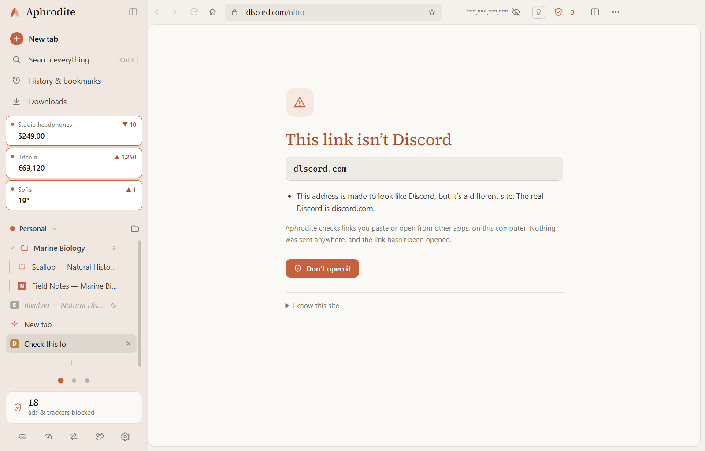
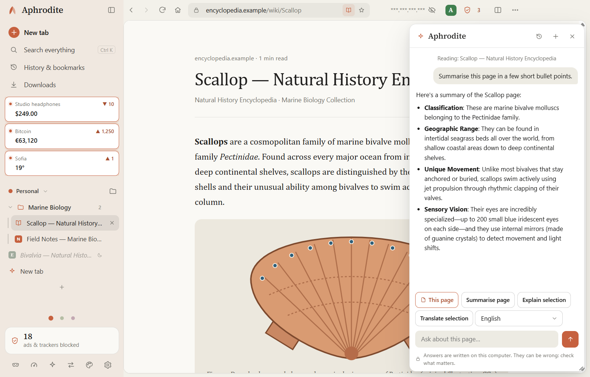
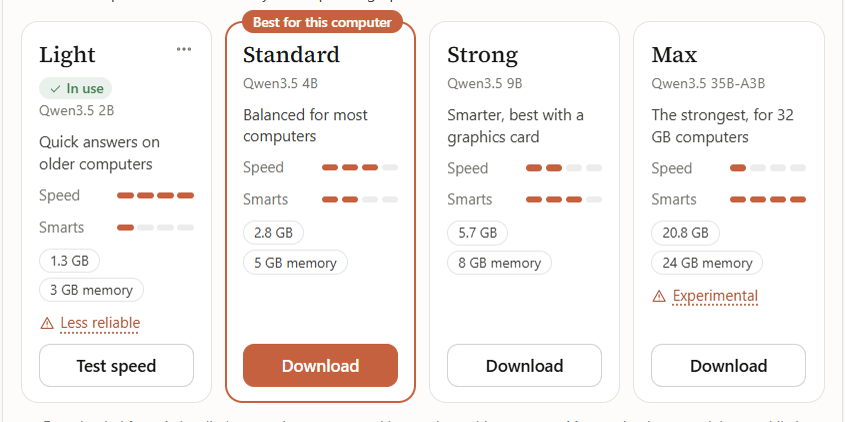
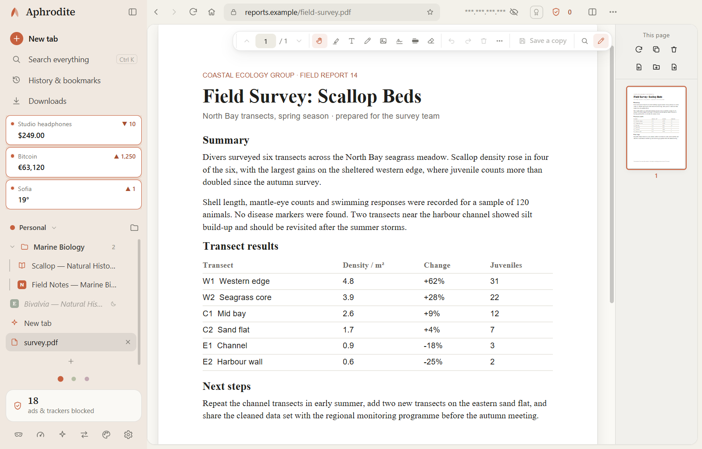
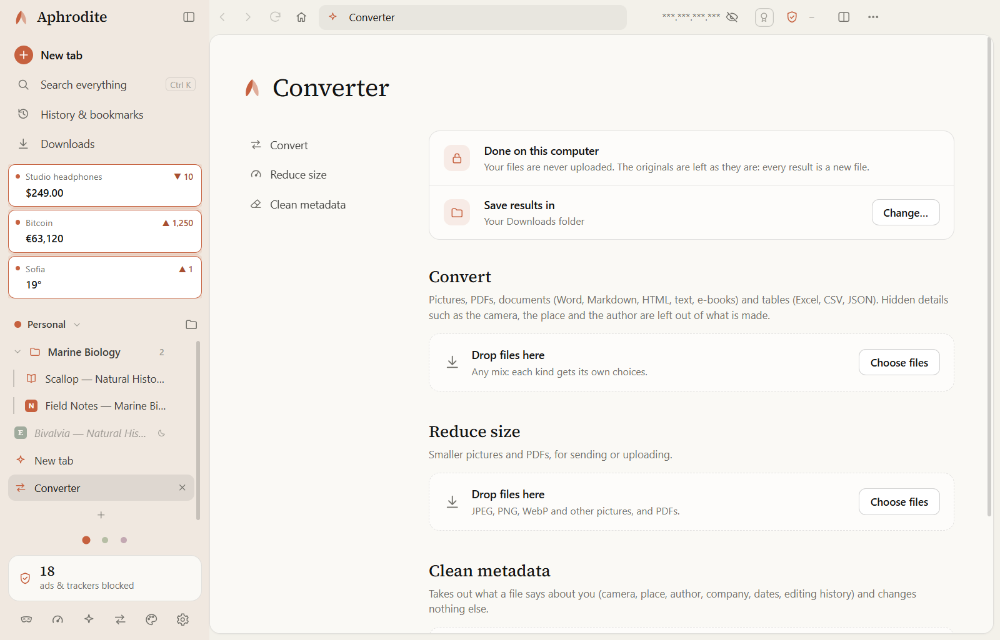

# Aphrodite

**A calm, private browser for Windows and Linux.** 
No accounts. No telemetry. No ads. Just the web, quietly.

&nbsp;

&nbsp;

Windows 10 and 11 (64-bit) · Linux (64-bit, AppImage or .deb) · Free

  

<picture>
  <source media="(prefers-color-scheme: dark)" srcset="assets/newtab-dark.png">
  
</picture>

 

<table>
<tr>
<td width="33%" valign="top">

### 🛡️ Private by default
Ads, trackers and cookie pop-ups are handled before a page finishes loading. Nothing to set up.

</td>
<td width="33%" valign="top">

### 🎭 Hard to fingerprint
Every site sees its own made-up device, so sites can't link your visits. Sign-ins still work.

</td>
<td width="33%" valign="top">

### 🔗 Safer links
Links you paste or open from Discord, email and other apps are checked for IP loggers, lookalikes and fake sign-in pages.

</td>
</tr>
<tr>
<td width="33%" valign="top">

### ✨ An assistant that stays home
Ask about the page you're on. The AI runs on your own computer, so nothing you ask leaves it.

</td>
<td width="33%" valign="top">

### 📄 PDFs and files, offline
Read, edit, sign and truly redact PDFs, and convert or clean files, all without uploading anything.

</td>
<td width="33%" valign="top">

### 🎨 Built to be yours
Vertical tabs, workspaces with separate logins, live clips, split and reader view, and a live theme studio.

</td>
</tr>
</table>

---

## 🛡️ Shields & privacy receipts

Every site gets a **shield panel** (left) with its own switches, and a **privacy receipt** (right) that names every company that tried to follow you, what was blocked, and which device details got made-up answers.

<table>
<tr>
<td width="50%" valign="top" align="center">
 
<b>Shield panel</b>: a privacy grade from <b>S</b> to <b>F</b>, the tracker count, and a switch for each protection
</td>
<td width="50%" valign="top" align="center">
 
<b>Privacy receipt</b>: every company blocked, third-party cookies refused, and fingerprinting attempts answered with made-up values
</td>
</tr>
</table>

- **Blocks ads, trackers, disguised (CNAME) trackers and session-recording scripts** automatically.
- **Says no to cookie pop-ups for you**, through each site's own menus, and lets you take consent back later without signing out.
- **HTTPS-Only, Secure DNS, WebRTC leak protection and Global Privacy Control**, plus tracking tags removed from links.
- **Phishing and malware warnings** use lists stored on your computer, refreshed twice a day (or right away with **Update now**), plus about **390,000 known scam sites** built in. The addresses you visit are never sent anywhere.
- **Bot checks work** (Cloudflare, hCaptcha, reCAPTCHA, Arkose, DataDome) without lowering your protection. For a stubborn site, **Trust this site** fixes it and keeps other companies' trackers blocked.

---

## 🔗 Link protection

Make Aphrodite your **default browser** (Settings → General), and links from Discord, email and chat open in it. Every link you **paste** or **open from another app** is checked on your computer before it loads:

- **IP loggers** such as Grabify and IPLogger are stopped, because opening one shows your IP address to whoever made the link.
- **Lookalike addresses** like `dlscord.com`, `rnicrosoft.com` or names spelled with letters from another alphabet are flagged, with the odd letters marked.
- **Disguised links** like `discord.com.free-nitro.ru` or `microsoft.com@another-site` show you the real site.
- **Redirects are followed**, so a harmless-looking short link can't hand you on to a lookalike.
- **Fake sign-in pages** that call themselves Discord, Steam, PayPal and others, and ask for your password on an address that isn't theirs, get a warning before you type.
- **Lookalikes of any well-known site**, like `liches.com` for lichess.org, get a warning with a button to the real site.
- **Strict mode** (on by default) asks before opening a site that isn't one of the 100,000 best-known and isn't in your bookmarks. Small real sites open with one click.

Only a site's name counts, never the rest of the link, so real links like `discord.com/channels/…` pass straight through. Nothing is looked up online.

---

## ✨ An on-device assistant

Open the assistant from the sidebar to **summarise** a page, **explain** or **translate** what you selected, or just ask about it. It runs an open-source language model **on your own computer**: what you ask and the pages it reads never leave it, and its engine has no network access at all. It's off until you turn it on, and nothing is downloaded until you choose a model.

Four sizes, from **Light** for older computers to **Max** for computers with 32 GB of memory. Aphrodite looks at your computer and suggests the one that fits. Like every AI, it can be wrong, so check anything that matters.

---

## 📄 PDFs, redaction & the Converter

<table>
<tr>
<td width="50%" valign="top" align="center">
 
<b>PDF editor</b>: highlight, type, draw, add pictures, sign and organise pages. Redaction burns the boxes in, so the words underneath are really gone.
</td>
<td width="50%" valign="top" align="center">
 
<b>Converter</b>: change formats (pictures, PDFs, documents, e-books, spreadsheets), make files smaller and strip hidden details such as the camera, place and author.
</td>
</tr>
</table>

Everything happens in a locked-down page on your computer: files are never uploaded, a file can't contact a website while it's open, and the original is always left as it was.

Aphrodite also opens **web pages saved on your computer** (.html files), handy for previewing a project's `index.html`. They can only reach files on your own computer.

---

## 🗂️ Workspaces, tab folders & the `Ctrl+K` command palette

Keep tabs by project or context, without juggling separate browser profiles:

<table>
<tr>
<td width="50%" valign="top" align="center">
 
<b>Workspaces, folders & sleeping tabs</b>: each workspace can have its own <b>separate logins</b>, its own <b>protection level</b> (Strict, Balanced, Compatible) and its own <b>Studio theme</b>
</td>
<td width="50%" valign="top" align="center">
 
<b>Command palette (<code>Ctrl+K</code>)</b>: jump to any open tab in any workspace, open split or reader view, put tabs to sleep, or run your own shortcuts
</td>
</tr>
</table>

---

## 📖 Split view & reader view

Open any two tabs side by side (`Ctrl+\` or drag a tab onto the page), and press `F9` on an article for a calm, distraction-free **reader view**:

---

## 📌 Live clips

Right-click any price, score, status or chart on a page and choose **Clip this part of the page**. Clips stay live in your sidebar and on the new tab board with a small history graph, checked quietly in the background (with your logins or anonymously), and can notify you when a value changes.

---

## 🎨 Studio: make it yours

Open **Studio** from the sidebar to restyle every part of Aphrodite as you watch. Everything stays on your computer, survives updates, and turns off at once with `Ctrl+Shift+Alt+M`:

- **13 built-in themes:** *Aphrodite*, *Sage*, *Harbor*, *Plum*, *Rosewater*, *Graphite*, *Typewriter*, *Lavender*, *Ember*, *Glacier*, *Moss*, *Espresso* and *Midnight*. Aphrodite's window and taskbar icon recolour to match.
- **Every colour:** window, page, panels, inputs, sidebar and toolbar, separately for light and dark mode. Share a theme as a short `APH1.` code.
- **Shape and type:** corner roundness, sidebar width, heading and interface fonts, tab height, tab title motion (*Typewriter*, *Pencil*, *Slide*) and new-tab wallpapers.
- **Your own buttons, sliders and CSS:** add buttons, live sliders and switches to the toolbar or sidebar, write CSS for any website, or restyle any of Aphrodite's 90+ named interface parts.

---

## 🎭 Fingerprint protection & an honest privacy guide

Sites try to recognise your device from your graphics card, drawings, sound, fonts and hardware. Aphrodite gives every site **its own made-up device**: different on every site so your visits can't be linked, the same on one site so you stay signed in, and brand new in every private window.

Settings → **Privacy guide** explains in plain words what Aphrodite hides, what **no browser** can hide on its own, how it checks links and files, where each protection reaches, and when it doesn't apply.

---

## ❓ FAQ

<b>Windows says "Windows protected your PC". Is that safe?</b>

 
The installer isn't code-signed yet, so Windows doesn't recognise the publisher. Click <b>More info</b>, then <b>Run anyway</b>. Only download Aphrodite from this page.

<b>Does Aphrodite collect anything about me?</b>

 
No. There's no account, no telemetry, no crash reporting and no analytics. The few connections it makes by itself (updates and filter lists) are listed in the <a href="PRIVACY.md">privacy policy</a>.

<b>Can I make it my default browser?</b>

 
Yes. Go to Settings → General → Default browser. On Windows, this opens Windows' Default apps page with Aphrodite selected: click <b>Set default</b>. On Linux, Aphrodite sets itself up. Links from other apps then open in Aphrodite and are checked first.

<b>Does the assistant send anything anywhere?</b>

 
No. The model runs on your computer, and its engine has no network access at all. The only download is the model itself, from this page's releases, when you choose one in Settings → Assistant.

<b>How do updates work?</b>

 
Aphrodite checks this page every few hours and updates itself quietly. Every download is verified before it's installed. You can turn automatic updates off in Settings.

<b>Does it support Chrome extensions?</b>

 
Not right now. Ad blocking, cookie pop-up refusal and tracker protection are built in, so most people won't need them.

<b>Is Aphrodite open source?</b>

 
No. Aphrodite is free to use, but it's proprietary software. The open-source parts it's built on are credited in the <a href="THIRD-PARTY-NOTICES.md">third-party notices</a>.

---

## ⚠️ Important notice

> **Brand-new accounts risk false-positive bot suspensions:**
> Newly made accounts on websites like GitHub or Reddit might be suspended upon posting. This is a known issue I am actively working to resolve. Accounts with existing history and reputation work properly; however, newly made accounts—especially when using Aphrodite—carry a risk of being suspended by automated filters mistaking the browser for a bot. If you don't want to waste time with support teams, please be careful about this. If this ever happens to you, please notify me at **simplecarbon@proton.me** (or open an issue) so I can investigate and fix it.

---

## About this project

Aphrodite isn't backed by a huge company, a big engineering team, or someone who is extremely experienced in coding. It's a personal project by a solo builder, and I don't come from a traditional coding background. I started building Aphrodite because I was bored and wanted a private, custom browser that felt like mine and gave me the security and privacy I wanted—and modern AI tools finally made it possible to bring that vision to life. Therefore, if you don't trust or support AI tools' capabilities and safety measures, I would not recommend downloading this browser, as most of it was built using them (thanks to all the agents that worked on this project).

Because this is an independent project, it will likely have errors, rough spots, mistakes, and things that were missed—and it also means your feedback goes directly to me. If something breaks, doesn't work properly, feels awkward, could be better, or if you just have a crazy idea that could be cool, write to **simplecarbon@proton.me** or open an issue. I'd love to hear from all the testers and improve this project based on your experiences.

— **SolidCarbon**, SolidCarbon Works

---

[Changelog](CHANGELOG.md) · [Privacy policy](PRIVACY.md) · [EULA](EULA.md) · [Trademarks](TRADEMARKS.md) · [Third-party notices](THIRD-PARTY-NOTICES.md)

© 2026 **SolidCarbon Works** · simplecarbon@proton.me

