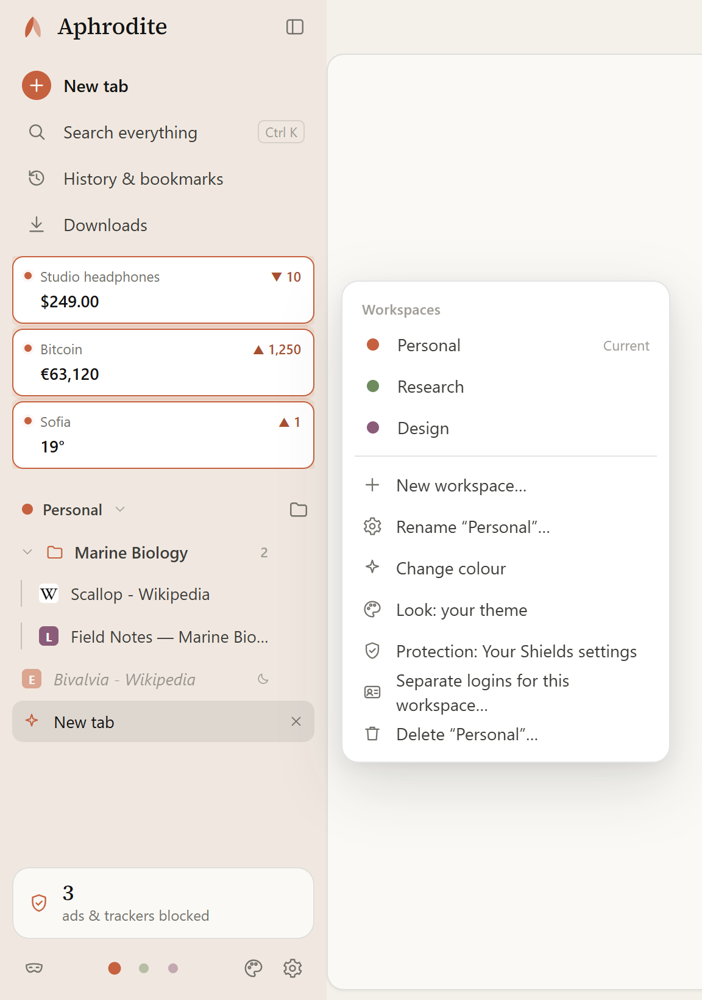
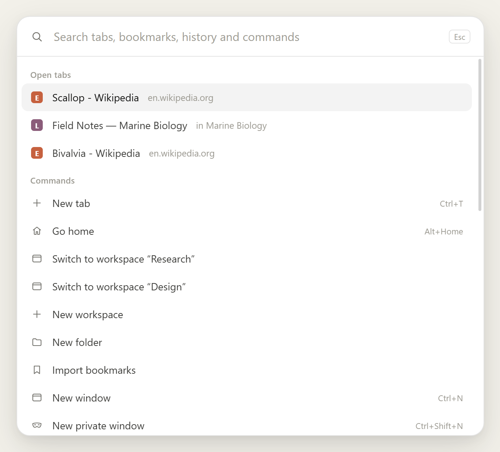
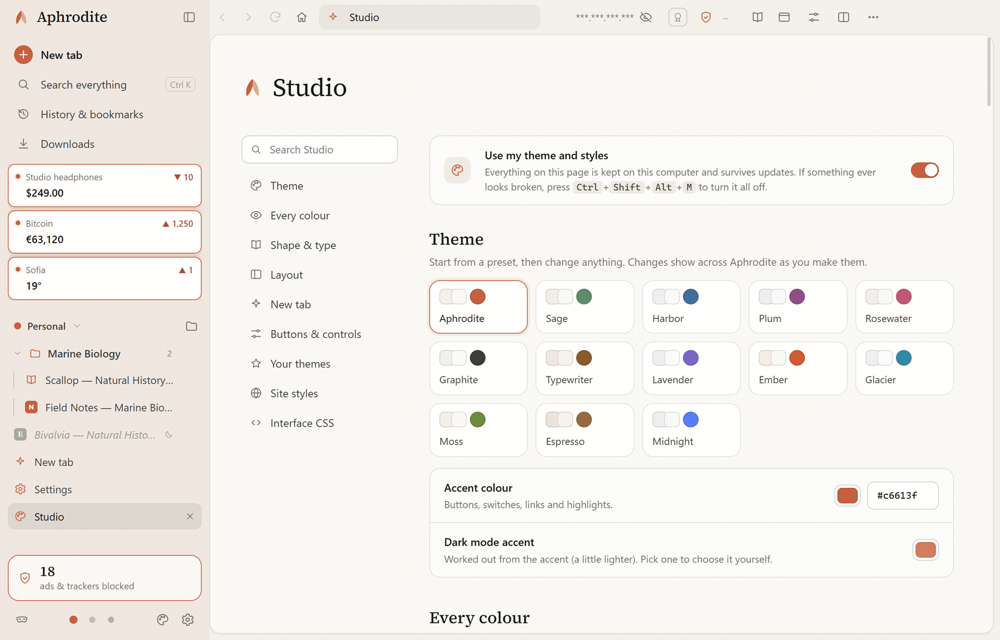

# Aphrodite

**A calm, private browser for Windows and Linux.** 
No accounts. No telemetry. No ads. Just the web, quietly.

&nbsp;

&nbsp;

  

<picture>
  <source media="(prefers-color-scheme: dark)" srcset="assets/newtab-dark.png">
  
</picture>

 

<table>
<tr>
<td width="33%" valign="top">

### 🛡️ Private by default
Ads, trackers and cookie pop-ups are handled before a page even finishes loading. Nothing to configure.

</td>
<td width="33%" valign="top">

### 🎭 Hard to fingerprint
Every site sees its own made-up device, so sites can't link your visits across the web. Sign-ins still work.

</td>
<td width="33%" valign="top">

### 🎨 Built to be yours
Vertical tabs, workspaces with separate logins, live page clips, split view, reader view, and a live theme & CSS studio.

</td>
</tr>
</table>

---

## 🛡️ Shields & Privacy Receipts

Every site gets a **Shield panel** (left) with per-site switches and a **Privacy receipt** (right) naming every company that tried to follow you, what was blocked, and which device details received made-up answers.

<table>
<tr>
<td width="50%" valign="top" align="center">
 
<b>Shield panel</b> — Per-site privacy grade (<b>S</b> to <b>F</b>), tracker counter, and individual protection switches
</td>
<td width="50%" valign="top" align="center">
 
<b>Privacy receipt</b> — Every company blocked, third-party cookies refused, and fingerprinting probes faked
</td>
</tr>
</table>

- **Blocks ads, trackers, CNAME-cloaked trackers, and session replay scripts** automatically.
- **Refuses cookie pop-ups for you** using each site's own menus, and lets you withdraw consent later without signing out.
- **HTTPS-Only, Secure DNS, WebRTC leak protection, Global Privacy Control**, and automatic link-tracking removal.
- **Phishing and malware warnings** run against lists stored on your computer — the addresses you visit are never sent anywhere.
- **Bot checks work** (Cloudflare, hCaptcha, reCAPTCHA, Arkose, DataDome) without lowering your protection. For a stubborn site, **Trust this site** fixes it while keeping third-party trackers blocked.

---

## 🗂️ Workspaces, Tab Folders & `Ctrl+K` Command Palette

Organize tabs by project or context without juggling separate browser profiles:

<table>
<tr>
<td width="50%" valign="top" align="center">
 
<b>Workspaces, folders & sleeping tabs</b> — Each workspace can have its own <b>separate logins</b>, its own <b>protection level</b> (Strict, Balanced, Compatible), and its own <b>Studio theme</b>
</td>
<td width="50%" valign="top" align="center">
 
<b>Command palette (<code>Ctrl+K</code>)</b> — Jump to any open tab across workspaces, trigger split view or reader view, sleep background tabs, or run custom shortcuts
</td>
</tr>
</table>

---

## 📖 Split View & Reader View

Open any two tabs side by side (`Ctrl+\` or drag a tab onto the page) and press `F9` on any article for a calm, distraction-free **Reader view**:

---

## 📌 Live Clips

Right-click any price, score, status or chart on any webpage and choose **Clip this part of the page**. Clips stay live in your sidebar and on the new tab board with a sparkline history graph, checked quietly in the background (with your logins or anonymously) and optional desktop notifications when a value changes.

---

## 🎨 Studio: Make It Yours

Open **Studio** from the sidebar to customize every part of Aphrodite in real time — everything stays on your computer, survives updates, and can be turned off instantly with `Ctrl+Shift+Alt+M`:

- **13 built-in themes:** *Aphrodite*, *Sage*, *Harbor*, *Plum*, *Rosewater*, *Graphite*, *Typewriter*, *Lavender*, *Ember*, *Glacier*, *Moss*, *Espresso*, and *Midnight*.
- **Every surface & text colour:** Customize window, page, panel, input, sidebar, and toolbar colours separately for light and dark mode, or share themes as a short `APH1.` code.
- **Shape, typography & layout:** Adjust corner roundness (`0%–160%`), sidebar width, heading & interface fonts, tab height, tab title motion (*Typewriter*, *Pencil*, *Slide*), and new-tab wallpapers.
- **Your own buttons, sliders & CSS:** Add custom buttons, live CSS variable sliders, and switches to the toolbar or sidebar; write custom CSS for any website; or inspect and restyle any of Aphrodite's 90+ named interface parts.

---

## 🎭 Fingerprint Protection & Honest Privacy Guide

Sites try to recognize your device from your graphics card, canvas, audio, fonts, and hardware. Aphrodite gives every site **its own made-up device profile** — different on every site so visits can't be linked, consistent on a single site so logins stay signed in, and brand-new in every Private window.

Settings → **Privacy guide** explains in plain words what Aphrodite hides, what **no browser** can hide on its own, where each protection reaches, and when it doesn't apply.

---

## ❓ FAQ

<b>Windows says "Windows protected your PC". Is that safe?</b>

 
The installer isn't code-signed yet, so Windows doesn't recognise the publisher. Click <b>More info</b>, then <b>Run anyway</b>. Only download Aphrodite from this page.

<b>Does Aphrodite collect anything about me?</b>

 
No. There's no account, no telemetry, no crash reporting and no analytics. The few connections it makes by itself (updates and filter lists) are listed in the <a href="PRIVACY.md">privacy policy</a>.

<b>How do updates work?</b>

 
Aphrodite checks this page every few hours and updates itself quietly. Every download is verified before it's installed. You can turn automatic updates off in Settings.

<b>Does it support Chrome extensions?</b>

 
Not right now. Ad blocking, cookie pop-up refusal and tracker protection are built in, so most people won't need them.

<b>Is Aphrodite open source?</b>

 
No. Aphrodite is free to use, but it's proprietary software. The open-source parts it's built on are credited in the <a href="THIRD-PARTY-NOTICES.md">third-party notices</a>.

---

## About this project

Aphrodite isn't backed by a huge company, a big engineering team, or someone who is extremely experienced in coding. It's a personal project by a solo builder, and I don't come from a traditional coding background. I started building Aphrodite because I was bored and wanted a private, custom browser that felt like mine and gave me the security and privacy I wanted—and modern AI tools finally made it possible to bring that vision to life. Therefore, if you don't trust or support AI tools' capabilities and safety measures, I would not recommend downloading this browser, as most of it was built using them (thanks to all the agents that worked on this project).

Because this is an independent project, it will likely have errors, rough spots, mistakes, and things that were missed—and it also means your feedback goes directly to me. If something breaks, doesn't work properly, feels awkward, could be better, or if you just have a crazy idea that could be cool, write to **simplecarbon@proton.me** or open an issue. I'd love to hear from all the testers and improve this project based on your experiences.

— **SolidCarbon**, SolidCarbon Works

---

[Changelog](CHANGELOG.md) · [Privacy policy](PRIVACY.md) · [EULA](EULA.md) · [Trademarks](TRADEMARKS.md) · [Third-party notices](THIRD-PARTY-NOTICES.md)

© 2026 **SolidCarbon Works** · simplecarbon@proton.me

