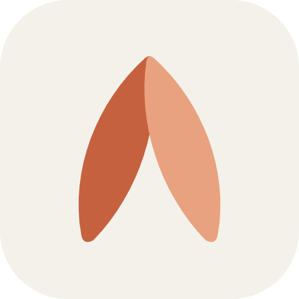
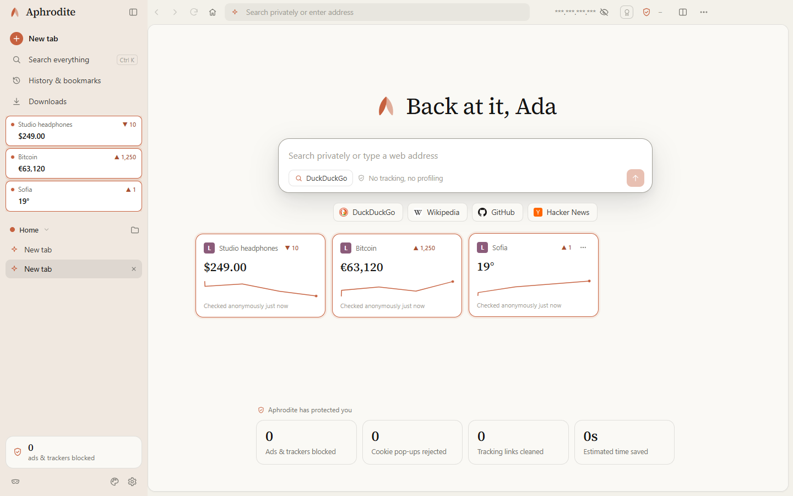
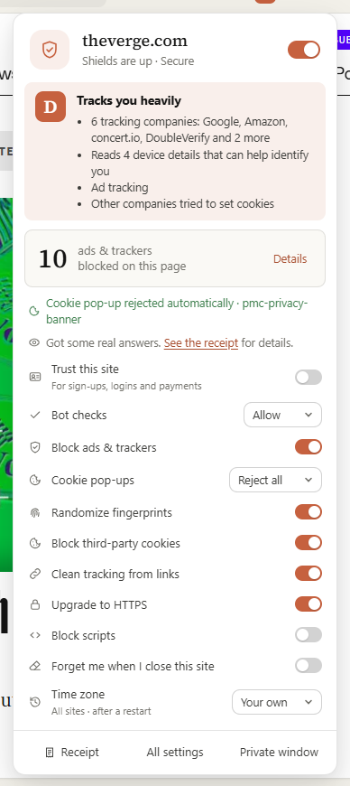
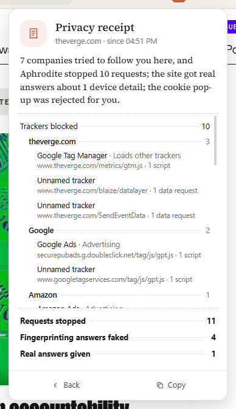
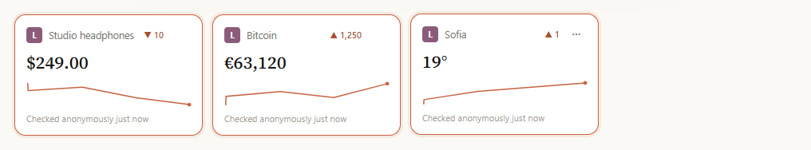
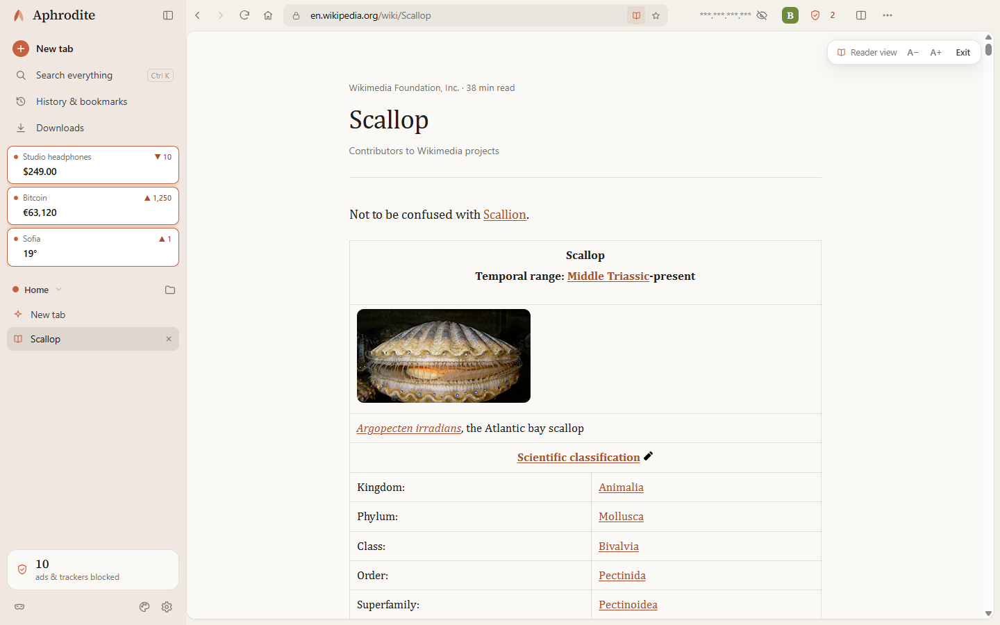
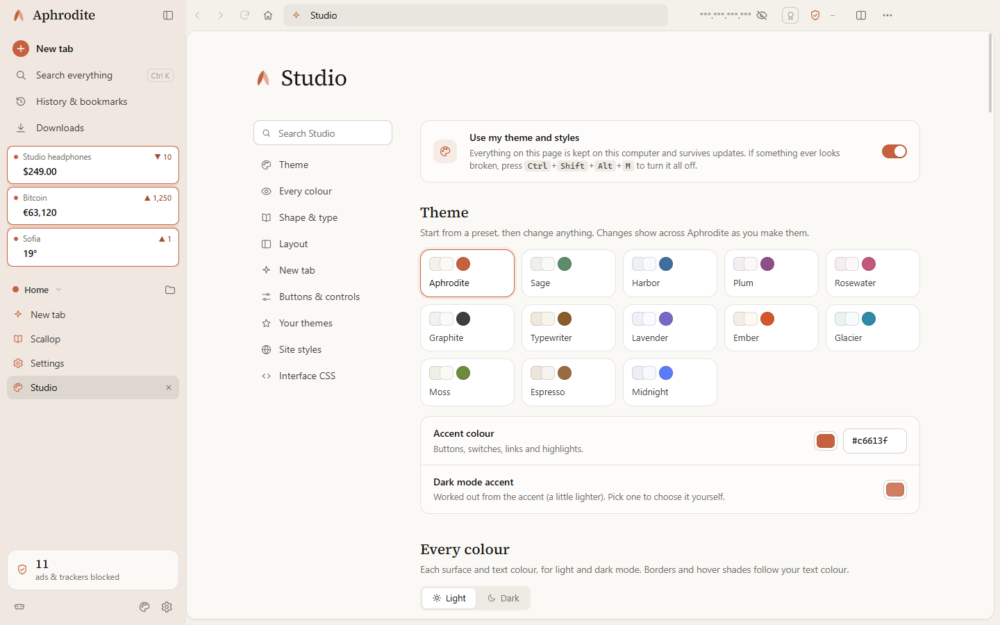
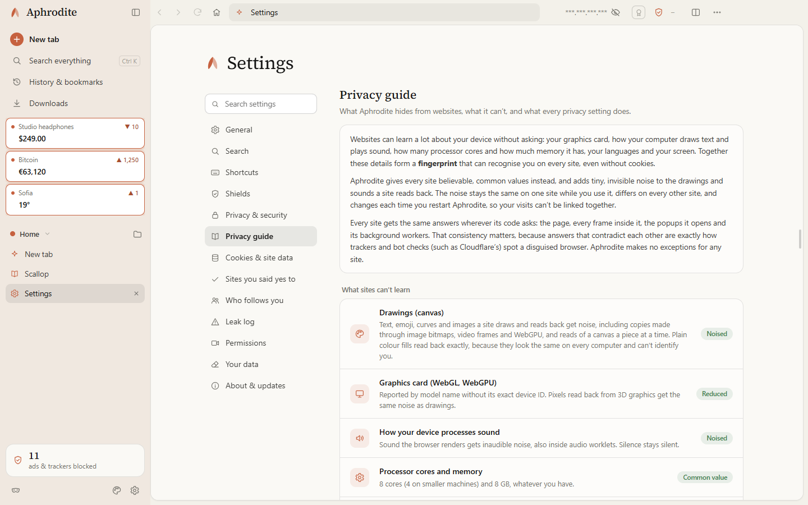

# Aphrodite

**A calm, private browser for Windows.** 
No accounts. No telemetry. No ads. Just the web, quietly.

&nbsp;

  

<picture>
  <source media="(prefers-color-scheme: dark)" srcset="assets/newtab-dark.png">
  
</picture>

 

<table>
<tr>
<td width="33%" valign="top">

### 🛡️ Private by default
Ads, trackers and cookie pop-ups are handled before a page even finishes loading. You don't have to set anything up.

</td>
<td width="33%" valign="top">

### 🎭 Hard to fingerprint
Every site sees its own made-up device, so sites can't follow you around the web. Sign-ups still work.

</td>
<td width="33%" valign="top">

### ✨ Calm to use
Warm, quiet design, vertical tabs and workspaces, and nothing that sends your data anywhere.

</td>
</tr>
</table>

---

## 🛡️ Security & privacy

<table>
<tr>
<td width="50%" valign="top">

</td>
<td width="50%" valign="top">

**Every site gets a shield panel.** It shows how heavily the site tracks you, what was blocked, and a switch for each protection on that site alone.

- **Blocks ads and trackers**, including trackers disguised as the site's own address, and session-recording services.
- **Refuses cookie pop-ups for you**, using each site's own menus.
- **HTTPS-Only.** Every connection is encrypted, and you're warned before any site that can't be.
- **Phishing and malware warnings** use lists kept on your computer. The pages you visit are never sent anywhere.
- **Secure DNS, WebRTC leak protection, Global Privacy Control**, and removal of tracking tags from links.
- **Bot checks work.** Sign-up and login checks (Arkose, DataDome, hCaptcha, reCAPTCHA, Cloudflare) work without lowering your protection. For a stubborn site, **Trust this site** fixes it, while other companies' trackers stay blocked.

</td>
</tr>
</table>

## 🧾 Privacy receipts

<table>
<tr>
<td width="50%" valign="top">

**See exactly what each site tried.** The receipt names every company that tried to follow you, what each tracker is for, and which device details the site asked for. It also shows which of those got made-up answers.

- **A privacy grade** for every site, from **S** (tried nothing) down.
- **"Who follows you"** shows the companies that turn up across the sites you visit.
- **"What changed since your last visit"** flags new trackers, more data sharing, or an edited privacy policy.

</td>
<td width="50%" valign="top">

</td>
</tr>
</table>

## 🎭 Fingerprint protection

Sites can try to recognise your device from your graphics card, screen, fonts, audio and more. Aphrodite gives each site **its own made-up answers**:

| | |
|---|---|
| **Different on every site** | Sites can't link your visits to each other. |
| **The same on one site** | A site you log in to sees a returning device, not a stranger every time. It lasts as long as you keep that site's cookies. |
| **Everywhere a site can look** | The page, every frame inside it, popups, and every kind of background worker. |
| **Undetectable** | The protection looks and behaves like the browser's own code, so sites can't tell it's there. |
| **Private windows** | Get brand-new answers every time you open Aphrodite. |

## 📌 Live Clips

<table>
<tr>
<td width="50%" valign="top">

**Keep any part of any page live.** Right-click a price, a score, a status or a chart and choose **Clip this part of the page**.

- Clips sit in the **sidebar** and on the **new tab board**, with a **graph of how the value changed**.
- Checked in the background with shields on, either **as you** (your logins) or **anonymously**.
- An optional **Windows notification** when something changes.
- If a site is redesigned, the clip tells you and lets you pick the part again.

</td>
<td width="50%" valign="top">

</td>
</tr>
</table>

## 📖 Reader view & everyday browsing

Reader view, **vertical tabs**, **workspaces** (each with its own protection level, and its own logins if you want), tab folders, **split view**, a command palette (`Ctrl+K`), sleeping tabs, session restore, private windows and bookmark import from other browsers.

## 🎨 Studio: make it yours

Themes, every colour, shape and type, layout, your own buttons and sliders, styles for websites, and CSS for any part of Aphrodite. Everything stays on your computer and survives updates.

## 📚 A privacy guide that tells the truth

Settings → **Privacy guide** explains, in plain words, what Aphrodite hides, what it **can't** hide, where each protection reaches and when it doesn't apply.

---

## ❓ FAQ

<b>Windows says "Windows protected your PC". Is that safe?</b>

 
The installer isn't code-signed yet, so Windows doesn't recognise the publisher. Click <b>More info</b>, then <b>Run anyway</b>. Only download Aphrodite from this page.

<b>Does Aphrodite collect anything about me?</b>

 
No. There's no account, no telemetry, no crash reporting and no analytics. The few connections it makes by itself (updates and filter lists) are listed in the <a href="PRIVACY.md">privacy policy</a>.

<b>How do updates work?</b>

 
Aphrodite checks this page every few hours and updates itself quietly. Every download is verified before it's installed. You can turn automatic updates off in Settings.

<b>Does it support Chrome extensions?</b>

 
Not right now. Ad blocking, cookie pop-up refusal and tracker protection are built in, so most people won't need them.

<b>Is Aphrodite open source?</b>

 
No. Aphrodite is free to use, but it's proprietary software. The open-source parts it's built on are credited in the <a href="THIRD-PARTY-NOTICES.md">third-party notices</a>.

---

[Changelog](CHANGELOG.md) · [Privacy policy](PRIVACY.md) · [EULA](EULA.md) · [Trademarks](TRADEMARKS.md) · [Third-party notices](THIRD-PARTY-NOTICES.md)

© 2026 **SolidCarbon Works** · simplecarbon@proton.me

